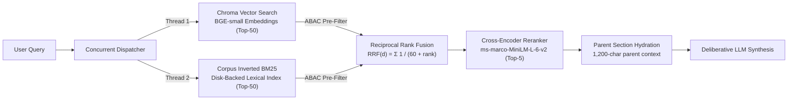

<div align="center">

# 🛡️ AegisRAG
### Enterprise Agentic Knowledge Platform & Partitioned Multi-Department RAG
**Air-Gapped Privacy • Sub-40ms Neural Routing • True Dual-Retriever Fusion • Zero Cloud Egress**

[](https://www.python.org/)
[](https://fastapi.tiangolo.com/)
[](frontend)
[](#architecture--hexagonal-ports--adapters)
[](https://github.com/convaiinnovations/laya)
[](https://ollama.com/)
[](https://www.trychroma.com/)
[](#true-dual-retriever-hybrid-search)
[](#enterprise-security--governance)
[-brightgreen)](backend/tests)
[](#license)

<p align="center">
  <a href="#product-overview">Product Overview</a> •
  <a href="#core-product-features">Key Features</a> •
  <a href="#architecture--hexagonal-ports--adapters">Architecture</a> •
  <a href="#quickstart--installation">Quickstart</a> •
  <a href="#true-dual-retriever-hybrid-search">Hybrid Retrieval</a> •
  <a href="#enterprise-security--governance">Security & IAM</a> •
  <a href="#api-reference">API Reference</a> •
  <a href="#enterprise-verification">Verification</a>
</p>

</div>

---

## Product Overview

**AegisRAG** is an enterprise-grade, dual-engine knowledge retrieval and synthesis platform engineered specifically for regulated, air-gapped, and zero-data-exfiltration environments—including financial institutions, defense organizations, legal firms, and healthcare networks.

Standard enterprise RAG platforms fail because of two architectural bottlenecks:
1. **The Shared Vector Monolith**: Ingesting all organizational knowledge into a single vector bucket leaks executive payroll, security keys, and legal records across employee clearance levels.
2. **The ReAct Latency Trap**: Multi-turn LLM reasoning loops spend 15 to 25 seconds deciding which database to query before retrieval even begins.

AegisRAG eliminates these compromises with a **Dual-Process Cognitive Architecture** and a decoupled **Hexagonal (Ports & Adapters)** design:
* **System 1 (Sub-40ms Neural Triage)**: Non-autoregressive classification resolves zero-trust security checks, department partition routing, and conversational query condensation in a single sub-40ms forward pass.
* **System 2 (Deliberative Local Synthesis)**: High-precision LLM reasoning (Llama 3) synthesizes grounded answers strictly from verified, cross-encoder reranked context with real-time token streaming.
* **True Dual-Retriever Fusion**: Runs dense vector search and full-corpus BM25 inverted lexical search concurrently, fusing candidate pools via Reciprocal Rank Fusion ($k=60$) so exact identifiers (`log_9021`, `req-4402`, UUIDs) are never missed.
* **Air-Gapped & Pluggable**: Pure domain logic runs completely decoupled from underlying storage. Deploy locally on a workstation (SQLite + Chroma + Local Ollama) or horizontally on private enterprise cloud (Aurora PostgreSQL + Qdrant + vLLM).

---

## Core Product Features

### 🏢 Partitioned Multi-Department Tenancy
* **Physical Partition Isolation**: Independent business units (HR, Finance, IT, Engineering, Legal) maintain isolated vector partitions, lexical indices, and knowledge graphs.
* **Concurrent Cross-Department Queries**: Queries spanning multiple departments (e.g. Finance + HR) execute departmental agents in parallel via `ThreadPoolExecutor`, halving end-to-end response times.

### 🛡️ Zero-Trust Enterprise Security & IAM
* **OAuth2 RFC 7519 JWT Bearer Tokens**: Cryptographically signed access tokens with configurable TTL and zero-trust validation at API ingress.
* **Document-Level ABAC Pre-Filtering**: Documents are tagged at ingestion (`restricted`, `confidential`, `internal`). Clearance is enforced directly inside database query clauses, preventing unauthorized documents from ever entering prompt context.
* **Elevated HMAC Sudo Barrier**: Destructive actions (department document wipe, user account removal, hardware re-sync) require a 5-minute elevated cryptographic Sudo token.
* **Tamper-Evident Hash-Chain Audit Ledger**: Every security-sensitive transaction is recorded in an unbroken append-only SHA-256 hash chain resistant to local log tampering.

### 🔍 True Dual-Retriever Hybrid Search & RRF
* **Corpus-Wide BM25 Inverted Index**: Unlike pseudo-hybrid systems that only rescore top dense hits, AegisRAG maintains an incremental, disk-backed BM25 inverted index across the entire departmental corpus.
* **Reciprocal Rank Fusion (RRF $k=60$)**: Blends dense vector semantics with exact lexical tokens on a scale-invariant rank basis.
* **Cross-Encoder Calibration**: Evaluates joint query-document relevance (`ms-marco-MiniLM-L-6-v2`) to winnow the top-50 fused candidates to the top-5 most relevant passages.
* **Parent-Child Section Assembly**: 300-character child vector hits are automatically hydrated into complete 1,200-character parent sections with duplicate removal.

### ⚡ Sub-Second Streaming UX & Desktop Shell
* **Real-Time Token Streaming**: Streams Server-Sent Events / NDJSON chunks directly to the React 19 UI, achieving Time-To-First-Token (TTFT) < 400ms.
* **Universal App Launcher**: Single-command launcher (`python -m app.launcher`) with dynamic port conflict resolution (8000 -> 8001...) and automated browser dispatch.
* **Prompt Injection Firewall**: Retrieved passages are strictly delimited within `<document_context>` XML tags with active directives instructing System 2 to treat document text as untrusted passive reference data.

---

## Architecture & Hexagonal Ports & Adapters

AegisRAG isolates pure RAG business logic from infrastructure using a rigid Hexagonal (Ports & Adapters) design. Adapters can be switched via configuration without changing core domain code:

```
+-----------------------------------------------------------------------------------+
|                                 INGRESS ADAPTERS                                  |
|     React 19 SPA Client  |  FastAPI REST Gateway  |  Universal Desktop Shell     |
+-----------------------------------------+-----------------------------------------+
                                          |
                                          v
+-----------------------------------------------------------------------------------+
|                                 CORE DOMAIN LOGIC                                 |
|                                                                                   |
|   +-----------------------+   +-----------------------+   +-------------------+   |
|   |   Master Agent RAG    |   |  Department Agent     |   | System 1 Decision |   |
|   |   (Concurrent Query)  |   |  (Dual Retrieval)     |   | (Sub-40ms Triage) |   |
|   +-----------------------+   +-----------------------+   +-------------------+   |
|   | Parent-Child Chunking |   | Corpus-Wide BM25 + RRF|   | Cross-Encoder     |   |
+-----------------------------------------+-----------------------------------------+
                                          |
                                          v
+-----------------------------------------------------------------------------------+
|                        PLUGGABLE INFRASTRUCTURE PORTS                             |
|                                                                                   |
|  Port                  HomeLab / Air-Gap Workstation     Enterprise Cloud / AWS   |
|  ------------------    -----------------------------     ----------------------   |
|  StorageProvider  ---> Local Disk Filesystem             AWS S3 / MinIO Storage   |
|  StateProvider    ---> SQLite (WAL Mode, Pooled)         PostgreSQL / Aurora RDS  |
|  VectorProvider   ---> ChromaDB (Embedded)               Qdrant Distributed       |
|  GraphProvider    ---> SQLite Graph + NetworkX           KùzuDB / Neo4j           |
|  InferenceProvider---> Local Ollama Engine               vLLM Continuous Batching |
+-----------------------------------------------------------------------------------+
```

---

## Quickstart & Installation

### Option 1: Automated 1-Command Setup (Recommended)

The included [`setup.sh`](setup.sh) discovery engine auto-detects your OS, CPU cores, RAM, and NVIDIA GPU/CUDA, provisions secrets, compiles frontend assets, and starts the system:

```bash
# 1. Clone the repository
git clone https://github.com/Priyanshu-200607/Agentic-Rag-System.git
cd Agentic-Rag-System

# 2. Run the automated setup wizard
chmod +x setup.sh
./setup.sh
```

*(Non-interactive CI/CD deployment)*:
```bash
./setup.sh --docker --admin-pass "YourSecurePassword123!"
```

---

### Option 2: Docker Compose (GPU Workstation / Server)

Deploy with full NVIDIA GPU acceleration (RTX 3060/4060/4070/4090, A100/H100) or CPU fallback:

```bash
# Start with NVIDIA GPU passthrough:
docker compose -f docker-compose.yml -f docker-compose.gpu.yml up -d

# Or run in CPU-only mode:
docker compose up -d

# Stream real-time backend logs:
docker compose logs -f backend
```

---

### Option 3: Native Host / Desktop Shell (Bare-Metal Workstation)

```bash
# 1. Create and activate virtual environment
python3 -m venv .venv
source .venv/bin/activate

# 2. Install dependencies (modular profile)
pip install --upgrade pip
pip install -r backend/requirements.txt

# 3. Initialize hardware configuration & admin credentials
python3 backend/setup_hardware.py
python3 backend/scripts/setup_admin.py --password "YourSecurePassword123!" --force

# 4. Launch universal desktop application
python -m app.launcher
```

* **Web Application**: [http://localhost:8000](http://localhost:8000)
* **OpenAPI Documentation**: [http://localhost:8000/docs](http://localhost:8000/docs)
* **Default Admin Account**: Username: `admin` | Password: Set during initial setup.

---

## True Dual-Retriever Hybrid Search

Most RAG systems claiming "hybrid search" only run BM25 on the top-20 documents already returned by vector search. If dense vector search misses a rare serial number or exact log ID, BM25 never gets to see it.

AegisRAG solves this with **Corpus-Wide Dual Retrieval**:



1. **Dense Search (Top-50)**: Captures semantic concepts, synonyms, and natural language descriptions.
2. **Corpus-Wide Lexical Search (Top-50)**: Inverted postings scan the complete departmental corpus for exact identifiers (`req-4402`, `log_9021`, part numbers).
3. **Reciprocal Rank Fusion**: RRF merges rankings by relative position without fragile score normalization.
4. **Cross-Encoder Calibration**: Neural cross-attention rescores the top-50 pool down to the top-5 verified context passages.

---

## Enterprise Security & Governance

```
                    +------------------------------------------+
                    |          Zero-Trust API Ingress          |
                    +--------------------+---------------------+
                                         |
                       [OAuth2 JWT Bearer Token Assertion]
                                         |
            +----------------------------+----------------------------+
            v                                                         v
 [Employee / Standard Role]                                    [Administrator]
            |                                                         |
  [Department Partition RBAC]                               [Admin Sudo Barrier]
 (Access strictly checked)                              (5-minute HMAC-signed token)
            |                                                         |
            v                                                         v
[Document-Level ABAC Pre-Filter]                         [Destructive Administrative Actions]
restricted   -> Blocked (admin only)                      - Purge department knowledge base
confidential -> Blocked (manager / admin)                 - Delete user accounts
internal     -> Allowed                                   - Hardware re-benchmarking
            |                                                         |
            +----------------------------+----------------------------+
                                         |
                                         v
                     [Append-Only SHA-256 Hash Chain Ledger]
                       (prev_hash -> entry -> record_hash)
```

### Cryptographic Hash-Chain Audit Ledger
Every authentication event, query triage decision, document upload, and destructive purge is committed to [`backend/security_audit.jsonl`](backend/security_audit.jsonl) with cryptographic chaining:

$$\text{record\_hash}_i = \text{SHA256}(\text{record\_hash}_{i-1} \parallel \text{timestamp} \parallel \text{event} \parallel \text{actor} \parallel \text{IP} \parallel \text{status} \parallel \text{details})$$

Tampering with, truncating, or modifying any previous line invalidates the ledger verification signature (`AuditLedger.verify_integrity()`).

---

## Hardware Auto-Profiling & Dynamic Sizing

At startup, [`platform_runtime/hardware_probe.py`](backend/platform_runtime/hardware_probe.py) benchmarks CPU instruction sets (AVX/AVX2/AVX-512), core topology, physical RAM, and GPU VRAM via NVIDIA NVML. It assigns the node to an operational tier:

| Tier | Hardware Profile | KG Extraction Batch | Vector Query Batch | Chunk / Overlap | Precision Mode |
|---|---|---|---|---|---|
| `gpu_enterprise` | VRAM >= 20 GB (A100, RTX 3090/4090) | 128 | 10,000 | 1,000 / 200 | FP16 Full |
| `gpu_server` | VRAM >= 12 GB (RTX 4070, T4) | 32 | 5,000 | 750 / 150 | FP16 Full |
| `gpu_workstation` | VRAM < 12 GB (RTX 3060, RTX 4060 8 GB) | 16 | 2,500 | 600 / 120 | 8-bit Quantized |
| `cpu_server` | RAM >= 32 GB, Cores >= 16 (Xeon / EPYC) | 16 | 4,000 | 800 / 150 | Multi-Thread CPU |
| `cpu_basic` | Standard workstation / laptop | 4 | 500 | 500 / 100 | INT8 ONNX |

- **Thread Topology Tuning**: Pins OpenMP, MKL, and PyTorch thread counts directly to physical core allocations to eliminate CPU context-switching overhead.
- **Memory Backpressure**: Monitors host RAM pressure. When usage exceeds 90%, batch sizes are dynamically halved, SQLite WAL journals are committed, and garbage collection is forced.

---

## API Reference

### 🔐 Authentication & Session
| Method | Endpoint | Description | Security |
|---|---|---|---|
| `POST` | `/api/auth/login` | Authenticate credentials and receive OAuth2 access token | Public |
| `POST` | `/api/setup` | Provision master administrator on first boot | Uninitialized |
| `GET` | `/api/setup/status` | Check if initial administrator provisioning is complete | Public |
| `POST` | `/api/admin/verify-sudo` | Issue 5-minute elevated HMAC-signed Sudo barrier token | Admin Creds |

### 💬 Conversational Retrieval & Streaming
| Method | Endpoint | Description | Security |
|---|---|---|---|
| `POST` | `/api/chat` | Stream multi-department RAG response via NDJSON | Authenticated |
| `GET` | `/api/chat/sessions` | List active chat sessions for authenticated user | Authenticated |
| `POST` | `/api/chat/session` | Create new conversation session | Authenticated |
| `GET` | `/api/chat/session/{id}` | Retrieve chat message history for session | Session Bound |
| `DELETE` | `/api/chat/session/{id}` | Delete conversation session and associated history | Session Bound |

### 📂 Multi-Modal Document Management
| Method | Endpoint | Description | Security |
|---|---|---|---|
| `POST` | `/api/upload` | Ingest documents (PDF, DOCX, TXT, Images) with sensitivity tag | Admin / Manager |
| `GET` | `/api/history` | List authorized documents in accessible departments | Authenticated |
| `DELETE` | `/api/upload/{dept}/{file}` | Delete specific file from vector and BM25 index | Admin |
| `DELETE` | `/api/upload/{dept}` | Complete partition purge (documents, vector, graph) | **Admin + Sudo** |

### ⚙️ Governance & Health Monitoring
| Method | Endpoint | Description | Security |
|---|---|---|---|
| `GET` | `/api/admin/users` | List users, roles, and authorized departments | Admin |
| `POST` | `/api/admin/users` | Provision new user account with hashed credentials | **Admin + Sudo** |
| `DELETE` | `/api/admin/users/{name}` | Delete user account | **Admin + Sudo** |
| `PUT` | `/api/admin/users/{name}/suspend`| Toggle user account active / suspended status | Admin |
| `PUT` | `/api/admin/users/{name}/access` | Update user authorized department clearances | Admin |
| `GET` | `/api/admin/departments` | List active departmental partitions | Admin |
| `POST` | `/api/admin/departments/{name}`| Create new isolated departmental partition | Admin |
| `DELETE` | `/api/admin/departments/{name}`| Delete department and purge all associated data | **Admin + Sudo** |
| `GET` | `/api/system/health` | Container readiness and health status check (`200 OK`) | Public |
| `GET` | `/api/system/status` | Real-time CPU, RAM, GPU, storage metrics, and worker queue | Admin |
| `POST` | `/api/admin/system/hardware-sync` | Hot-sync hardware benchmark without restarting | **Admin + Sudo** |
| `GET` | `/api/admin/logs` | Real-time security audit ledger and system log stream | Admin |

---

## Enterprise Verification

AegisRAG maintains an un-mocked integration and unit test suite verifying zero-trust authentication, cryptographic hash chaining, corpus-wide BM25 indexing, prompt injection defense, and multi-department concurrency:

```bash
cd backend
pytest tests -v
```

### Verification Scoreboard

| Test Suite | Focus Area | Tests | Status |
|---|---|---|---|
| [`test_corpus_bm25.py`](backend/tests/test_corpus_bm25.py) | Corpus-wide BM25 inverted index, exact ID retrieval, disk persistence, ABAC filtering | 6 | **PASSED** |
| [`test_streaming_synthesis.py`](backend/tests/test_streaming_synthesis.py) | Concurrent multi-department querying, token streaming, `<document_context>` prompt guard | 4 | **PASSED** |
| [`test_abac_security.py`](backend/tests/test_abac_security.py) | Sensitivity tagging, clearance hierarchy, and ChromaDB pre-filtering clauses | 2 | **PASSED** |
| [`test_agent_orchestrator.py`](backend/tests/test_agent_orchestrator.py) | Full query semantic preservation and sub-40ms System 1 routing | 2 | **PASSED** |
| [`test_auth_jwt.py`](backend/tests/test_auth_jwt.py) | RFC 7519 OAuth2 JWT encoding, expiration enforcement, and tamper detection | 5 | **PASSED** |
| [`test_auth_security.py`](backend/tests/test_auth_security.py) | PBKDF2 password hashing, Sudo tokens, query condensation, zero-trust empty scope | 12 | **PASSED** |
| [`test_final_move.py`](backend/tests/test_final_move.py) | System 1 answer judge, security firewall, KG duplicate node pruning | 5 | **PASSED** |
| [`test_hexagonal_integration.py`](backend/tests/test_hexagonal_integration.py) | Hexagonal Ports & Adapters collaboration with zero circular dependencies | 3 | **PASSED** |
| [`test_state_sqlite.py`](backend/tests/test_state_sqlite.py) | SQLite WAL mode persistence, connection pooling, multi-user CRUD | 4 | **PASSED** |
| [`test_sudo_barrier.py`](backend/tests/test_sudo_barrier.py) | HMAC-signed Sudo barrier, IP binding, signature tampering rejection, token expiration | 4 | **PASSED** |
| **Total Test Suite** | **Comprehensive End-to-End Enterprise Verification** | **47** | **47 / 47 PASSED (100%)** |

---

## License

Released under the [MIT License](LICENSE).
