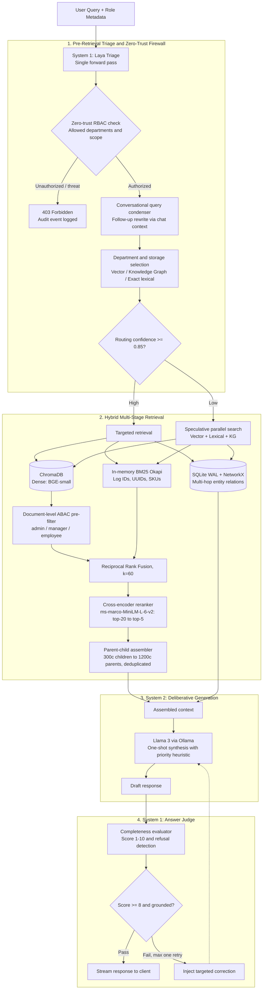

<div align="center">

# Multi-Department Agentic RAG System
### Dual-Process Architecture: System 1 (Laya) and System 2 (Llama 3)

**A fully on-premise Hybrid GraphRAG and vector platform that lets independent departments (HR, IT, Finance, Engineering, Legal) maintain strictly isolated knowledge bases. A non-autoregressive decision engine handles routing and security, hybrid lexical-dense retrieval with cross-encoder reranking handles recall, and nothing ever leaves the building.**

[](https://www.python.org/)
[](https://fastapi.tiangolo.com/)
[](frontend)
[-8A2BE2)](https://github.com/convaiinnovations/laya)
[-black?logo=ollama&logoColor=white)](https://ollama.com/)
[](https://www.trychroma.com/)
[](https://sqlite.org/)
[](#security-and-governance)
[](backend/tests)
[](#license)

<p>
  <a href="#executive-overview">Overview</a> |
  <a href="#system-architecture">Architecture</a> |
  <a href="#design-decisions">Design Decisions</a> |
  <a href="#capabilities-and-resolved-architectural-debts">Capabilities</a> |
  <a href="#hybrid-retrieval-and-reranking">Retrieval</a> |
  <a href="#security-and-governance">Security</a> |
  <a href="#hardware-auto-profiling">Hardware</a> |
  <a href="#api-reference">API</a> |
  <a href="#quickstart">Quickstart</a> |
  <a href="#verification">Verification</a>
</p>

</div>

---

## Executive Overview

This system is built for air-gapped, zero-data-exfiltration environments (financial institutions, defense contractors, healthcare networks, corporate legal teams) where sensitive data must never traverse a public cloud API.

Most enterprise RAG deployments fail in one of two ways: a single shared vector index that leaks data across business units, or an LLM agent loop that spends 10 to 20 seconds deciding what to do before it retrieves anything. This platform rejects both, on three principles.

1. **Routing, security, and quality control are classification problems, not generation problems.** A 421M-parameter non-autoregressive encoder solves them in a single forward pass, not an LLM reasoning token by token.
2. **Generation is reserved for the one step that needs it.** A local Llama 3 model synthesizes the answer from a small, reranked, access-filtered context.
3. **Isolation is structural, not advisory.** Departments are physically partitioned, and access control is enforced inside the database query, not after retrieval.

The result is a dual-process design:

- **System 1: Laya (ModernBERT-large, 421M).** Zero-trust access verification, intent classification, department and storage routing, conversational query condensation, and answer quality scoring, all in a single forward pass.
- **System 2: Llama 3 via Ollama.** Deliberative synthesis, grounded exclusively on reranked, deduplicated context.

Embedding generation, vector search, graph traversal, reranking, and synthesis all execute locally on bare metal or private containers.

---

## System Architecture



---

## Design Decisions

Each of the following was a deliberate trade-off, not a default.

| Decision | Rationale |
|---|---|
| **Encoder-based routing instead of a ReAct agent loop** | Each ReAct step is a sequential LLM generation. On local hardware that is 3 to 6 seconds per step, so 10 to 20 seconds per query. Typed decision heads on an encoder make the same calls in one pass. |
| **Open local Laya instead of a commercial semantic-routing API** | The alternative was a closed cloud service. External calls violate the zero-data-exfiltration requirement. |
| **SQLite (WAL) and NetworkX instead of Neo4j** | Neo4j requires a JVM holding 1.5 to 4 GB of RAM, memory an on-premise deployment needs for the LLM and embeddings. SQLite WAL provides ACID persistence, and NetworkX provides in-process traversal with no IPC overhead. |
| **Hybrid dense and lexical retrieval** | Dense embeddings capture meaning and miss exact identifiers (`log_9021`, UUIDs, SKUs). BM25 covers that blind spot. |
| **Reciprocal Rank Fusion over score blending** | Cosine distances and BM25 scores live on incompatible scales. RRF fuses by rank, so no calibration is needed. |
| **Parent-child chunking** | Small children give precise vector matches. Their parents give the LLM coherent context. Duplicate parents are removed before prompting. |
| **ABAC enforced inside the vector query** | Post-retrieval filtering risks restricted content entering a prompt. Pre-filtering in ChromaDB, with in-memory masking as defense in depth, closes that class of leak. |
| **Fail-closed security posture** | A missing dependency or empty authorization set denies access. It never degrades to open. |

---

## Capabilities and Resolved Architectural Debts

| Capability | Previous Bottleneck | Production Implementation |
|---|---|---|
| **Sub-second intent triage** | 10 to 20 s ReAct reasoning loops per step | Non-autoregressive **Laya** single forward pass (`decision_engine.py`). |
| **Hybrid search (dense + lexical)** | Pure dense embeddings missed exact log IDs, error codes, UUIDs | **BM25 Okapi** paired with ChromaDB vectors, fused via **RRF (k=60)** (`hybrid_search.py`). |
| **Two-stage reranking** | Cosine distance correlates weakly with relevance; context dilution | **Cross-encoder reranker** rescoring top-20 down to top-5 before prompt assembly (`reranker.py`). |
| **Hierarchical chunking** | Fixed-size chunks cut sentences mid-thought and lost parent context | **Parent-child chunking**: 300-char child vectors linked to 1,200-char parents (`document_processor.py`). |
| **Document-level ABAC** | Department-level RBAC exposed executive compensation to regular employees | Sensitivity tags, role clearance hierarchy, and ChromaDB pre-filtering (`department_agent.py`). |
| **Cryptographic authentication** | Plaintext passwords stored in `db.json` | **PBKDF2-HMAC-SHA256 (600,000 rounds)**, unique salts, constant-time verification, transparent migration, first-run setup (`auth.py`). |
| **Destructive-operation barriers** | Open admin sessions could wipe data without re-authentication | 5-minute **sudo token** (`/api/admin/verify-sudo`), `check_admin_sudo_barrier`, append-only audit log (`audit_logger.py`). |
| **Dynamic hardware provisioning** | Manual configuration and container boot command collisions | Auto-profiler (`hardware_probe.py`), boot chaining in `docker-compose.yml`, hot-sync via `./setup.sh --sync`. |
| **Streaming multi-modal OCR** | In-memory PDF conversion caused OOM on 100+ page scans | Page-by-page OCR fallback with OpenCV Otsu binarization; native `.png`, `.jpg`, `.jpeg`, `.tiff` support. |
| **Conversational query intelligence** | Follow-ups ("What about his manager?") lost conversation context | `condense_conversational_query` rewrites multi-turn queries before retrieval. |

---

## Hybrid Retrieval and Reranking

```
Query ---> In-memory BM25 (lexical) ------+
      |                                    +--> Reciprocal Rank Fusion --> Cross-Encoder --> Top-5 parent
      +--> ChromaDB dense vectors ---------+    (k=60)                      reranker         sections
```

1. **Candidate gathering.** ChromaDB returns the top-20 dense candidates under ABAC pre-filtering. BM25 returns lexical matches for exact alphanumeric tokens (`user_9821`, `log_9021`, `401k`). A SQLite/NetworkX traversal resolves multi-hop entity relations.
2. **Fusion.** Rankings are combined by rank, never by raw score:

   $$RRF(d) = \sum_{m \in M} \frac{1}{60 + r_m(d)}$$

3. **Reranking.** A cross-encoder (`cross-encoder/ms-marco-MiniLM-L-6-v2`) scores query-chunk pairs jointly through cross-attention, with a composite lexical-semantic scorer as a high-speed alternative.
4. **Parent assembly.** Child hits are replaced by enclosing parent sections, with overlapping parent IDs deduplicated.
5. **Synthesis and judgment.** Llama 3 generates a grounded answer with a chronological-priority heuristic for conflicting sources. System 1 scores completeness, and a failing answer triggers at most one targeted retry.

### Ingestion

- Formats: PDF, DOCX, TXT, CSV, JSON, PNG, JPG, JPEG, TIFF.
- PDFs are processed page by page. Pages with sparse text (under 40 characters) stream individually through PyTesseract OCR with OpenCV Otsu thresholding.
- Each document is classified for sensitivity at ingestion and tagged with `min_role`.
- Vector indexing is synchronous. Knowledge graph extraction runs in a background worker behind a semaphore to avoid GPU memory contention.
- Graph maintenance merges near-duplicate nodes (cosine similarity at or above 0.98) using collision-safe staging.

---

## Security and Governance

```
                      +----------------------------------------+
                      |            Zero-Trust Ingress          |
                      +--------------------+-------------------+
                                           |
                            [PBKDF2 Cryptographic Auth]
                                           |
              +----------------------------+----------------------------+
              v                                                         v
     [Normal User / Employee]                                    [Administrator]
              |                                                         |
    [Department-level RBAC]                                    [Admin Sudo Barrier]
   (HR / IT / Finance access)                              (5-minute elevated token)
              |                                                         |
              v                                                         v
   [Document-Level ABAC Filter]                            [Destructive Admin Actions]
 restricted   -> blocked (admin only)                       - Wipe department documents
 confidential -> blocked (manager / admin)                  - Delete user accounts
 internal     -> allowed                                    - Hardware re-benchmark
              |                                                         |
              +----------------------------+----------------------------+
                                           |
                                           v
                          [Append-Only JSONL Audit Logger]
                            (Timestamp, actor, IP, status)
```

### Cryptographic Authentication
- PBKDF2-HMAC-SHA256 with 600,000 rounds and 16-byte random salts.
- Constant-time comparison to prevent timing side channels.
- Legacy plaintext records in `db.json` are migrated transparently on first run.
- A mandatory first-run endpoint (`/api/setup`) provisions the master administrator.

### Elevated Admin Sudo Barrier
Destructive operations require a 5-minute token, bound to the administrator's IP and issued by `/api/admin/verify-sudo` after password re-entry:
- Department deletion: `DELETE /admin/departments/{name}`
- Department document purge: `DELETE /upload/{department}`
- User deletion: `DELETE /admin/users/{username}`
- Hardware re-benchmark: `POST /api/admin/system/hardware-sync`

### Document-Level ABAC
- Chunks carry `confidentiality` (`restricted`, `confidential`, `internal`) and `min_role` (`admin`, `manager`, `employee`).
- ChromaDB queries enforce clearance in the `where` clause, for example `{"$and": [{"min_role": {"$ne": "admin"}}, ...]}`.
- In-memory masking acts as defense in depth: unauthorized chunks never enter the BM25 index or the prompt context.

### Audit Trail
Failed logins, sudo elevations, uploads, and deletions are appended to `security_audit.jsonl` with UTC timestamp, client IP, actor, event type, and outcome. Required models are pre-cached by `download_models.py`, so the container runs fully offline (`HF_HUB_OFFLINE=1`).

---

## Hardware Auto-Profiling

At boot, `hardware_probe.py` inspects CPU instruction sets, core count, RAM, and GPU VRAM (via `nvidia-smi` with a PyTorch fallback). It classifies the host into one of five tiers, `setup_hardware.py` writes `hardware_config.json`, and `resource_manager.py` applies it at runtime.

| Tier | Profile | KG Batch | Vector Batch | Chunk / Overlap | SQLite Cache |
|---|---|---|---|---|---|
| `gpu_enterprise` | VRAM >= 20 GB (A100, RTX 3090/4090) | 128 | 10,000 | 1,000 / 200 | 2 GB |
| `gpu_server` | VRAM >= 12 GB (RTX 4070, T4) | 32 | 5,000 | 750 / 150 | 64 MB |
| `gpu_workstation` | VRAM < 12 GB (RTX 3060, 4060 8 GB) | 16 (8-bit) | 2,500 | 600 / 120 | 64 MB |
| `cpu_server` | RAM >= 32 GB, cores >= 16 (Xeon/EPYC) | 16 | 4,000 | 800 / 150 | 2 GB |
| `cpu_basic` | Standard workstation or laptop | 4 | 500 | 500 / 100 | 64 MB |

- **Boot chaining:** `setup_hardware.py` runs before Uvicorn starts.
- **Thread tuning:** `OMP`, `MKL`, and `Torch` thread counts follow the detected topology.
- **Backpressure:** above 90% RAM utilization, `ResourceManager.check_memory_pressure()` triggers garbage collection and halves batch sizes.
- **Runtime hot-sync:** after adding a GPU or memory, re-benchmark without rebuilding containers:

  ```bash
  ./setup.sh --sync
  ```

---

## Latency Budget

Design targets per stage on supported hardware.

| Stage | Target |
|---|---|
| System 1 triage and security check | < 40 ms |
| Hybrid retrieval, fusion, and rerank | < 80 ms |
| System 2 synthesis (Llama 3) | ~ 2.5 s |
| System 1 answer evaluation | < 25 ms |
| **End to end** | **< 3 s** |

For comparison, the replaced ReAct loop took 10 to 20 seconds, and the earlier LLM-based router and evaluator each added roughly 4 seconds.

---

## Repository Structure

```
Developement_rag/
  backend/
    api.py                  REST endpoints, NDJSON chat streaming, admin routes, SPA serving
    decision_engine.py      System 1: triage, firewall, query condensation, answer judge
    rag_system.py           MultiDeptRAG orchestrator and ingestion pipelines
    department_agent.py     Per-department retrieval, ABAC filter, fusion, rerank, synthesis
    hybrid_search.py        BM25 Okapi index and Reciprocal Rank Fusion
    reranker.py             Cross-encoder and composite candidate reranker
    document_processor.py   Parsers, streaming OCR, parent-child chunking
    kg_system.py            SQLite WAL graph, NetworkX, extraction, pruning
    auth.py                 Password hashing, sudo tokens, atomic DB writes
    audit_logger.py         Append-only JSONL audit trail
    hardware_probe.py       Low-level CPU/GPU discovery and tier classification
    setup_hardware.py       Generates hardware_config.json at boot
    resource_manager.py     Thread tuning, cache sizing, memory backpressure
    config.py               Centralized configuration and anchored paths
    models.py               Pydantic request/response schemas
    download_models.py      Offline model pre-caching
    scripts/
      setup_admin.py        CLI administrator provisioning and password rotation
    tests/                  Pytest suite (19 tests)
  frontend/                 React 19, Vite, Tailwind CSS: chat, admin console, system status
  setup.sh                  Unified enterprise platform setup & hardware discovery engine
  docker-compose.yml        Container orchestration
  docker-compose.gpu.yml    NVIDIA GPU passthrough override
```

---

## API Reference

### Authentication and Setup
| Method | Endpoint | Description | Guard |
|---|---|---|---|
| `POST` | `/login` | Authenticate credentials and return role | Public |
| `POST` | `/api/setup` | Configure master admin on first initialization | Uninitialized only |
| `POST` | `/api/admin/verify-sudo` | Issue 5-minute elevated sudo token | Admin |

### Conversational Retrieval
| Method | Endpoint | Description | Guard |
|---|---|---|---|
| `POST` | `/chat` | Stream resolution as NDJSON (`status`, `answer`) | Authenticated |
| `GET` | `/chat/sessions` | List the user's sessions | User-bound |
| `POST` | `/chat/session` | Create a session | Authenticated |
| `DELETE` | `/chat/session/{id}` | Delete a session | User-bound |

### Document Management
| Method | Endpoint | Description | Guard |
|---|---|---|---|
| `POST` | `/upload` | Ingest files into a department | Admin / Manager |
| `GET` | `/history` | List files and authorized departments | Authenticated |
| `DELETE` | `/upload/{dept}/{file}` | Delete a file and its graph edges | Admin |
| `DELETE` | `/upload/{dept}` | Purge all department documents and graph | **Admin + sudo** |

### Administration and System Status
| Method | Endpoint | Description | Guard |
|---|---|---|---|
| `GET` | `/admin/users` | List users, roles, and department access | Admin |
| `POST` | `/admin/users` | Create user with hashed credentials | **Admin + sudo** |
| `DELETE` | `/admin/users/{name}` | Delete user | **Admin + sudo** |
| `PUT` | `/admin/users/{name}/suspend` | Toggle active/suspended | Admin |
| `PUT` | `/admin/users/{name}/access` | Update allowed departments | Admin |
| `GET` | `/admin/departments` | List departments | Admin |
| `POST` | `/admin/departments/{name}` | Create department partition | Admin |
| `DELETE` | `/admin/departments/{name}` | Delete department and all data | **Admin + sudo** |
| `GET` | `/admin/system/status` | Live CPU, RAM, GPU, storage, background tasks | Admin |
| `POST` | `/api/admin/system/hardware-sync` | Re-benchmark and hot-swap hardware profile | **Admin + sudo** |
| `POST` | `/admin/system/cache/clear` | Invalidate entity cache and clear VRAM | Admin |
| `GET` | `/admin/logs` | System, query, and task logs | Admin |

---

## Quickstart & Provisioning

The project includes an intelligent, platform-aware setup engine (`./setup.sh`) that discovers your hosting platform (OS, CPU cores, RAM, NVIDIA GPU/VRAM, Docker, Ollama), provisions dependencies, hardens master credentials, and compiles assets.

### Automated Setup (Recommended)

```bash
# Run interactive setup engine (auto-detects Docker, GPU, and guides admin setup):
./setup.sh

# Or run non-interactively with specific deployment mode:
./setup.sh --docker                           # Automatic containerized stack with GPU passthrough
./setup.sh --native                           # Native bare-metal virtualenv & dependencies
./setup.sh --sync                             # Dynamic hardware re-benchmark & profile sync
./setup.sh --admin-pass "SuperSecret123!"     # Non-interactive CI/CD admin credential provisioning
```

The application is served at **http://localhost:8000** (interactive Swagger API docs at **http://localhost:8000/docs**).

---

## Verification

The suite covers routing latency, the security firewall, password hashing, ABAC filtering, the sudo token lifecycle and destructive-operation enforcement, zero-trust handling of empty department sets, BM25 with RRF, the cross-encoder, parent-child chunking, conversational condensation, hardware probing, admin setup CLI and lockdown, document format support, and knowledge-graph pruning integrity.

```bash
cd backend
pytest tests -v
```

```
tests/test_agent_orchestrator.py::TestAgentAndOrchestrator::test_routing_sub_millisecond PASSED
tests/test_agent_orchestrator.py::TestAgentAndOrchestrator::test_search_vector_db_receives_full_query PASSED
tests/test_auth_security.py::TestAuthSecurityAndRetrieval::test_audit_logger PASSED
tests/test_auth_security.py::TestAuthSecurityAndRetrieval::test_bm25_lexical_search_and_rrf PASSED
tests/test_auth_security.py::TestAuthSecurityAndRetrieval::test_conversational_query_condensation PASSED
tests/test_auth_security.py::TestAuthSecurityAndRetrieval::test_cross_encoder_reranker PASSED
tests/test_auth_security.py::TestAuthSecurityAndRetrieval::test_cryptographic_password_hashing PASSED
tests/test_auth_security.py::TestAuthSecurityAndRetrieval::test_document_level_abac_filtering PASSED
tests/test_auth_security.py::TestAuthSecurityAndRetrieval::test_hardware_probe PASSED
tests/test_auth_security.py::TestAuthSecurityAndRetrieval::test_parent_child_chunking PASSED
tests/test_auth_security.py::TestAuthSecurityAndRetrieval::test_setup_admin_cli_and_lockdown PASSED
tests/test_auth_security.py::TestAuthSecurityAndRetrieval::test_sudo_barrier_destructive_operations_enforcement PASSED
tests/test_auth_security.py::TestAuthSecurityAndRetrieval::test_sudo_token_lifecycle PASSED
tests/test_auth_security.py::TestAuthSecurityAndRetrieval::test_zero_trust_empty_allowed_departments PASSED
tests/test_final_move.py::TestFinalMoveImplementations::test_decision_engine_evaluation PASSED
tests/test_final_move.py::TestFinalMoveImplementations::test_decision_engine_security_guardrail PASSED
tests/test_final_move.py::TestFinalMoveImplementations::test_decision_engine_triage_routing PASSED
tests/test_final_move.py::TestFinalMoveImplementations::test_document_processor_image_support PASSED
tests/test_final_move.py::TestFinalMoveImplementations::test_kg_prune_duplicates_integrity_error_fix PASSED

============================== 19 passed in 3.18s ==============================
```

---

## Known Limitations and Roadmap

These are documented constraints with defined paths forward.

| Area | Current Limitation | Planned Direction |
|---|---|---|
| **Layout fidelity** | Text extractors and OCR flatten nested tables and multi-column layouts. | Vision-based document parsing that preserves structure and emits markdown tables. |
| **LLM serving** | Ollama serves requests sequentially, with no prefix caching under concurrency. | Dedicated inference engine (vLLM or SGLang) with continuous batching. |
| **Storage scale** | Single-node ChromaDB and SQLite single-writer locking limit horizontal scale. | Distributed vector store (Qdrant or Milvus) and PostgreSQL for metadata. |
| **Ingestion** | Uploads are manual, and stale versions persist after source changes. | CDC connectors (SharePoint, Drive, Confluence, Jira) with delta re-indexing. |
| **Observability** | Local file logging only, with no span-level tracing or automated retrieval regression. | OpenTelemetry tracing and CI-integrated evaluation (RAGAS or TruLens). |

---

## License

Released under the MIT License. See the `LICENSE` file for details.